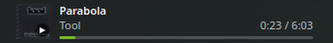

# Playbar

Компактний віджет «зараз грає» для панелі KDE Plasma 6. Без кнопок керування
і без спливного вікна — лише перемотування кліком по прогрес-бару.



- обкладинка альбому (квадрат на висоту панелі)
- назва треку і виконавець — два рядки або один рядок «Виконавець — Назва»;
  довгий текст плавно прокручується
- тонкий прогрес-бар під текстом; клік або перетягування по ньому перемотує трек
  (якщо плеєр це підтримує), при наведенні підказка показує час
- значок стану (грає / пауза) у куті обкладинки
- плавна зміна треку: обкладинка й текст згасають і з'являються знову
- колір прогрес-бару може братися з обкладинки альбому
- фіксована ширина в панелі (налаштовується)
- коли нічого не грає — віджет ховається з панелі
  (у режимі редагування панелі він видимий, щоб його можна було перемістити)
- підказка при наведенні: трек, виконавець, альбом, плеєр

Дані береться через MPRIS (модуль `org.kde.plasma.private.mpris`, той самий,
що й у вбудованого віджета «Медіаплеєр»), тож працює зі Strawberry та
будь-яким іншим MPRIS-сумісним плеєром. Зовнішніх залежностей немає — лише
те, що вже входить у Plasma 6.

## Встановлення

```sh
git clone https://github.com/43v3r-y0ung/playbar-plasmoid.git
cd playbar-plasmoid
kpackagetool6 -t Plasma/Applet -i .
```

Далі: правий клік на панелі → «Додати віджети…» → знайдіть **Playbar** і
перетягніть на панель.

Або завантажте готовий `playbar.plasmoid` з
[KDE Store](https://store.kde.org/) і встановіть його:

```sh
kpackagetool6 -t Plasma/Applet -i playbar.plasmoid
```

### Оновлення

```sh
kpackagetool6 -t Plasma/Applet -u .
plasmashell --replace &   # або вийти з сеансу й увійти знову
```

### Видалення

```sh
kpackagetool6 -t Plasma/Applet -r org.aeou.playbar
```

## Тестування без панелі

`plasmoidviewer` входить до пакета `plasma6-sdk`:

```sh
sudo zypper in plasma6-sdk
plasmoidviewer -a org.aeou.playbar -f horizontal -s 400x44
```

Помилки QML виводяться в термінал.

## Налаштування

| Параметр | За замовчуванням |
|---|---|
| Текст: два рядки / один рядок «Виконавець — Назва» | два рядки |
| Колір акценту (прогрес-бар) | `#73BA25` (зелений openSUSE) |
| Брати колір акценту з обкладинки (заданий колір — запасний) | так |
| Колір тексту / «Кольори теми Plasma» | кольори теми |
| Плеєр: активний (автоматично) або конкретний | активний |
| Ховати на паузі | ні |
| Ширина в панелі (фіксована) | 350 px |

Конкретний плеєр запам'ятовується за його desktop-entry (наприклад,
`org.strawberrymusicplayer.strawberry`), тож вибір зберігається після
перезапуску плеєра. Якщо вибраний плеєр не запущено, віджет прихований.

## Структура

```
metadata.json
contents/config/main.xml        схема налаштувань
contents/config/config.qml      сторінки налаштувань
contents/ui/main.qml            вибір плеєра, позиція, видимість
contents/ui/NowPlaying.qml      вигляд у панелі
contents/ui/ScrollingText.qml   рядок із прокручуванням
contents/ui/configGeneral.qml   сторінка «Загальне»
```

## Збирання `.plasmoid`

`.plasmoid` — це zip-архів пакета:

```sh
git archive --format=zip -o playbar.plasmoid HEAD metadata.json contents LICENSE
```

## Ліцензія

GPL-2.0-or-later, див. [LICENSE](LICENSE).
